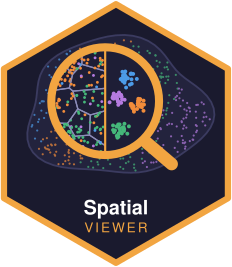
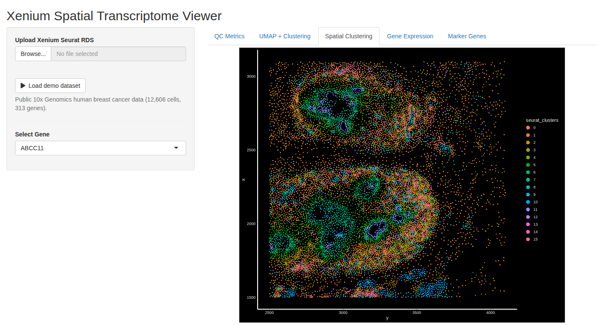
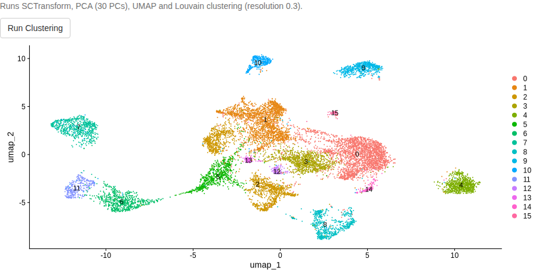
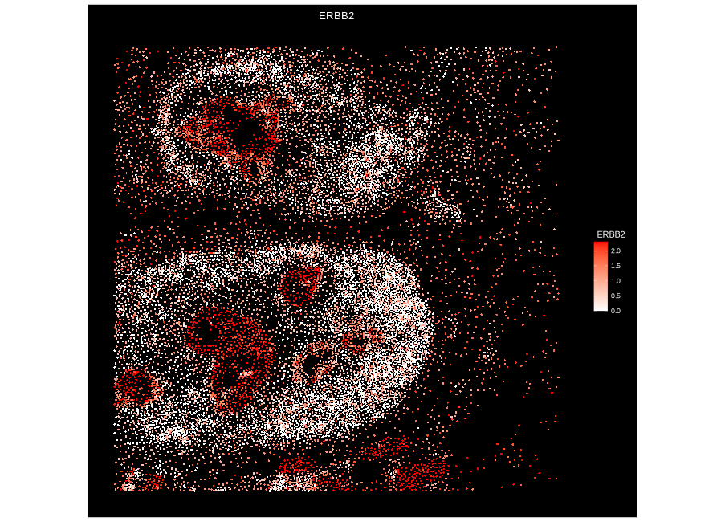
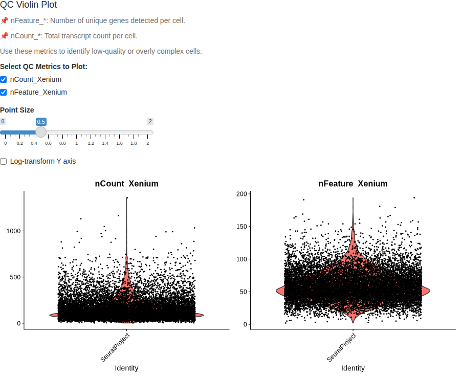
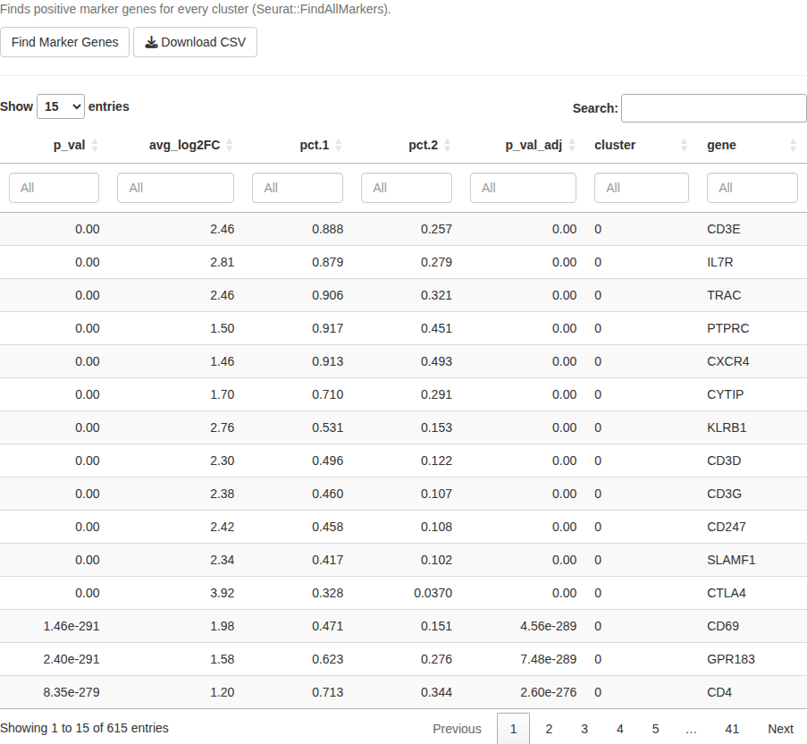
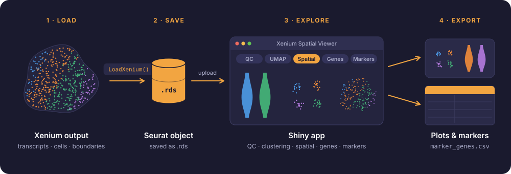

# Medicago Xenium Spatial Viewer 

**An interactive R Shiny app for exploring 10x Genomics Xenium *in situ* spatial transcriptomics data**


[](LICENSE)
[](https://github.com/MinYaoJhu/MedicagoXeniumSpatialViewer/actions/workflows/tests.yml)
[](https://doi.org/10.5281/zenodo.24093378)

`MedicagoXeniumSpatialViewer` lets you upload a Xenium Seurat object (`.rds`) and explore it in the browser: check cell quality, cluster cells, view clusters and gene expression on the tissue, and export marker genes. No R coding is needed after launch. It was built to explore *Medicago truncatula* root nodule Xenium data ([Jhu et al. 2026, bioRxiv](https://doi.org/10.64898/2026.06.23.733685)), and it works with any Xenium dataset loaded into Seurat.

## Features

| Tab | What it does |
|---|---|
| **QC Metrics** | Violin plots of genes and transcripts per cell (`nFeature_*`, `nCount_*`), with adjustable point size and log scale |
| **UMAP + Clustering** | One-click SCTransform → PCA → UMAP → graph-based clustering, with a progress bar |
| **Spatial Clustering** | Clusters mapped onto the tissue section coordinates |
| **Gene Expression** | Expression of any selected gene plotted on the tissue |
| **Marker Genes** | Marker genes for every cluster (`FindAllMarkers`), in a filterable table with CSV export |

## 📸 Screenshots

Screenshots use the bundled [demo dataset](data/README.md), a public 10x Genomics human breast cancer sample.



| UMAP + clustering | Gene expression (*ERBB2*) on the tissue |
|---|---|
|  |  |
| **QC metrics** | **Marker genes** |
|  |  |

## Workflow

<p align="center">
  
</p>

1. **Load** the Xenium output folder (transcripts, cell boundaries, cell-feature matrix) into Seurat with `LoadXenium()`.
2. **Save** the Seurat object as an `.rds` file.
3. **Explore** it in the app: QC, clustering and UMAP, clusters on the tissue, gene expression and marker genes.
4. **Export** plots and the marker gene table (`.csv`).

## 📂 Repository Structure

```
MedicagoXeniumSpatialViewer/
├── app.R                          # App launcher
├── modules/                       # Shiny modules (one per tab)
│   ├── ui_main.R                  # Page layout
│   ├── server_main.R              # Data loading and module wiring
│   ├── module_qc.R
│   ├── module_umap.R
│   ├── module_spatial.R
│   ├── module_gene_expression.R
│   └── module_markers.R
├── data/
│   ├── demo_xenium_breast.rds     # Demo dataset (2 MB)
│   └── README.md                  # Data source, citation and download record
├── data-raw/
│   └── make_demo_data.R           # Builds the demo dataset from public 10x files
├── scripts/
│   └── make_screenshots.R         # Regenerates README screenshots (shinytest2)
├── assets/
│   ├── logo.svg                   # Hex logo
│   ├── workflow.svg               # Workflow figure
│   ├── screenshots/               # README screenshots (scripts/make_screenshots.R)
│   ├── make_logo.py               # Reproducible figure generators
│   └── make_workflow.py
├── docs/
│   └── sessionInfo.txt            # Full R session used for testing
├── tests/                         # testthat + shinytest2 test suite
├── .github/workflows/tests.yml    # Runs the tests on GitHub for every push
├── environment.yml                # Tested conda environment
├── vignette.Rmd                   # Step-by-step tutorial
├── CITATION.cff
└── LICENSE
```

## Getting Started

### 1️⃣ Install required packages

**Option A – conda/micromamba (exact tested versions):**

```bash
micromamba create -f environment.yml
micromamba activate xenium-viewer
```

**Option B – install in your own R:**

```r
install.packages(c("shiny", "Seurat", "ggplot2", "DT"))
BiocManager::install("glmGamPoi")  # optional, makes SCTransform faster
```

### 2️⃣ Launch the app

```r
shiny::runApp("path/to/MedicagoXeniumSpatialViewer")
```

### 3️⃣ Try it with demo data

Click **Load demo dataset** in the sidebar, then go through the tabs from left to right. Clustering the 12,606 demo cells takes about 20 seconds.

> **About the demo data:** this is a small region of the public [10x Genomics Xenium preview dataset](https://www.10xgenomics.com/products/xenium-in-situ/preview-dataset-human-breast) of FFPE human breast cancer (*Sample 1, Replicate 1*; CC BY 4.0), first described in [Janesick et al., *Nature Communications* 2023](https://doi.org/10.1038/s41467-023-43458-x). It is included only to demonstrate the app and will be replaced by our *Medicago truncatula* root nodule Xenium dataset once the associated paper is published. The download date, file checksums and build script are documented in [`data/README.md`](data/README.md).

### 4️⃣ Use your own data

The app expects a Seurat object saved with `saveRDS()` that contains:

- an assay of Xenium counts (for example, created with `Seurat::LoadXenium()`)
- a spatial field of view (FOV), needed for the tissue plots
- optionally, existing `umap` and `seurat_clusters`; otherwise compute them in the **UMAP + Clustering** tab

```r
xenium_obj <- Seurat::LoadXenium("path/to/xenium_output_folder", fov = "fov")
saveRDS(xenium_obj, "xenium_obj.rds")
```

Uploads up to 5 GB are supported.

## ✅ Tests

The test suite checks the demo data, each tab's logic and a full run of the app in a headless browser. It runs automatically on GitHub for every change (see the **tests** badge above). To run it locally from the repository root:

```bash
Rscript tests/testthat.R
```

## 🧪 Tested Versions

The app was tested with the versions below (Linux, November 2026). If something does not work, a package version difference is a good first thing to check. The full R session is in [`docs/sessionInfo.txt`](docs/sessionInfo.txt).

| Package | Version |
|---|---|
| R | 4.4.3 |
| Seurat | 5.5.1 |
| SeuratObject | 5.4.0 |
| shiny | 1.14.0 |
| DT | 0.34.0 |
| ggplot2 | 4.0.3 |
| glmGamPoi | 1.18.0 |
| arrow / hdf5r (demo data script only) | 25.0.1 / 1.3.16 |
| shinytest2 (screenshot script only) | 0.5.1 |

## 🗺️ Roadmap

- [x] Demo dataset (a subset of a public 10x Genomics Xenium dataset) for a 30-second test run
- [ ] Replace the demo with the *Medicago truncatula* root nodule Xenium dataset after publication
- [ ] Interactive UMAP (plotly) and "color by" any metadata column
- [ ] Gene expression on UMAP alongside the tissue view
- [ ] PNG/PDF export of all plots
- [x] Tested conda environment (`environment.yml`) and recorded package versions
- [x] Automated tests and continuous integration (GitHub Actions)

## Related Repositories

- [Medicago_Rhizobia_Xenium_Analysis_Workflow](https://github.com/MinYaoJhu/Medicago_Rhizobia_Xenium_Analysis_Workflow): the full analysis pipeline for the Medicago Xenium study
- [Medicago_Xenium_relabeling_resegmentation](https://github.com/MinYaoJhu/Medicago_Xenium_relabeling_resegmentation): transcript relabeling and cell segmentation
- [Xenium_data_analysis_training](https://github.com/MinYaoJhu/Xenium_data_analysis_training): a 4-week training course on Xenium data analysis

## Citation

**Demo data** (CC BY 4.0, cited following the [10x Genomics citation guidelines](https://www.10xgenomics.com/support/software/cell-ranger/latest/miscellaneous/cr-citations)):

- High resolution mapping of the breast cancer tumor microenvironment using integrated single cell, spatial and in situ analysis of FFPE tissue: In Situ Sample 1, Replicate 1, Xenium In Situ Preview Dataset by Xenium Onboard Analysis v1.0.1, 10x Genomics, (accessed 2026, November 9).
- Janesick, A. et al. (2023). High resolution mapping of the tumor microenvironment using integrated single-cell, spatial and in situ analysis. *Nature Communications* 14: 8353, [doi:10.1038/s41467-023-43458-x](https://doi.org/10.1038/s41467-023-43458-x)

**This app:**

If you use this app in your research, please cite it with the **"Cite this repository"** button on GitHub (generated from [`CITATION.cff`](CITATION.cff)), or as:

> Jhu, M.-Y. (2026). *MedicagoXeniumSpatialViewer: an interactive Shiny app for Xenium spatial transcriptomics* (v1.0.0). Zenodo. https://doi.org/10.5281/zenodo.24093378

## AI assistance

Code refactoring, tests, documentation and figures in this repository were developed with the assistance of Claude Opus 5.5 (Anthropic), used through Claude Code. All changes were directed, reviewed and approved by the author, who takes full responsibility for the content.

## 📧 Contact

Maintainer: **Min-Yao Jhu**, Donald Danforth Plant Science Center
Email: [MJhu@danforthcenter.org](mailto:MJhu@danforthcenter.org)
Questions and bug reports are welcome as [GitHub Issues](https://github.com/MinYaoJhu/MedicagoXeniumSpatialViewer/issues).
